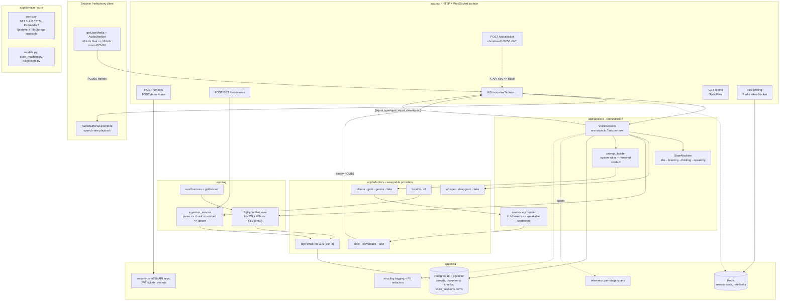
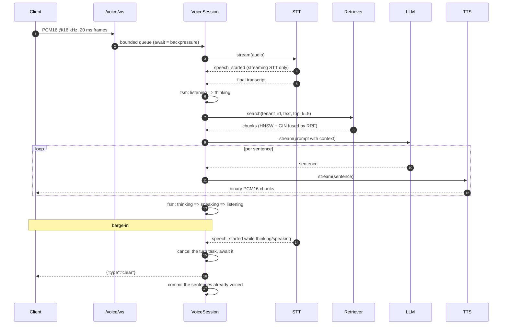

# Architecture - B2B Voice-AI RAG Backend

The system as it is actually built: a FastAPI service that accepts a microphone stream over a WebSocket, retrieves tenant-scoped knowledge with hybrid search, answers with an LLM, and streams synthesised speech back - with barge-in.

Rationale and the alternatives that were rejected live in [`ARCHITECTURE_NOTES.md`](ARCHITECTURE_NOTES.md), this document describes what exists, how a call flows through it, and what each piece costs.

---

## 1. Component diagram



Every provider is a `@runtime_checkable` `Protocol` in `app/domain/ports.py`, and `VoiceSession` only ever sees the protocol: it is handed `STT`, `LLM`,
`TTS` and `Retriever` instances by `app/api/deps.py`. Nothing in `app/pipeline`
imports a provider SDK, a database module or an HTTP client - the only two
`app/infra` imports in the whole package are `redact` (a regex) and the span
helpers (a context manager and a log line), both pure. That is why the same
session runs unchanged against the real stack and against test doubles.

## 2. One turn, end to end



Three properties of that diagram are load-bearing:

* **The turn is one task.** `VoiceSession._current_turn` is a single
  `asyncio.Task` wrapping LLM => chunker => TTS => socket. An interrupt cancels
  one task instead of signalling four subsystems, and the socket cannot emit
  audio after the cancel because the cancellation is awaited *before*
  `{"type":"clear"}` is sent.
* **Backpressure is the queue.** The WebSocket read loop `await`s
  `queue.put()` against a 200-frame buffer (4 s of audio), a slow provider
  therefore slows the client instead of growing an unbounded buffer in RAM.
* **What you hear is what is stored.** A `_tap()` records each sentence as it is
  handed to the TTS, so an interrupted turn commits the answer the user
  actually heard, not the answer the model was still writing.

## 3. Layering

| Layer    | Package        | Rule                                                                                                                                                              |
| -------- | -------------- | ----------------------------------------------------------------------------------------------------------------------------------------------------------------- |
| Domain   | `app/domain`   | Pure: models, the state machine, exceptions, protocol definitions. No I/O, no framework imports.                                                                  |
| Adapters | `app/adapters` | Concrete `STT`/`LLM`/`TTS`/`Embedder`/`FileStorage` implementations. Provider errors are mapped to domain exceptions here, nowhere else.                          |
| RAG      | `app/rag`      | Chunking, parsing, the hybrid retriever, the evaluation harness. Talks to the DB through SQLAlchemy, not to Postgres directly.                                    |
| Pipeline | `app/pipeline` | `VoiceSession`, the sentence chunker, the prompt builder. Depends on `domain/ports.py`, the only `app/infra` imports are the two pure helpers (`redact`, `span`). |
| API      | `app/api`      | Routes, auth dependencies, rate limiting, DTOs. No business logic.                                                                                                |
| Infra    | `app/infra`    | Settings, DB engine, Redis pool, structlog, OTel spans, secrets, ORM models, PII redaction.                                                                       |

Each provider is checked against the protocol in `app/domain/ports.py` by
`tests/unit/test_local_adapters.py`, `tests/unit/test_stt_tts_cloud.py`,
`tests/unit/test_llm_cloud.py` and the factory tests, and no adapter imports a
sibling adapter or anything from `app/pipeline`. `app/domain` itself contains no
I/O code at all, so it cannot depend on a framework.

## 4. Data model and tenant isolation

```
tenants ──< documents ──< chunks >── (embedding Vector(384), content_tsv tsvector)
   │
   ├──< voice_sessions (started_at, ended_at) ──< turns (role, content, created_at)
   └──  api_keys (key_hash sha256, never the key itself)
```

* **Every query filters on `tenant_id`.** Retrieval takes `tenant_id` as its
  first argument and both SQL legs (`WHERE tenant_id = :tid AND …`) are written
  that way, ingestion, listing, transcripts and document reads follow the same
  rule. Cross-tenant leakage is treated as a catastrophic failure, not a bug.
* **Embeddings are L2-normalised 384-dim** (`BAAI/bge-small-en-v1.5`), stored in
  `Vector(384)` and searched with `<=>` (cosine) - the metric that matches the
  normalised vectors.
* **Indexes:** HNSW (`m=16`, `ef_construction=64`, `vector_cosine_ops`) for the
  vector leg, GIN over the stored `tsvector` for the keyword leg.
* **Transcripts are redacted** with `redact()` before they are written or
  logged, and an interrupted turn commits only the sentences the user actually
  heard, so the stored conversation matches what was spoken.

## 5. Latency budget

Targets from the architecture notes, and what this implementation actually
measured on a CPU-only laptop (Piper `en_US-lessac-medium` + Whisper `base`/int8

+ Ollama, one turn, three sentences):

| Stage                             | Budget      | Measured                                           | Notes                                                                                                                                                                                                                                                                |
| --------------------------------- | ----------- | -------------------------------------------------- | -------------------------------------------------------------------------------------------------------------------------------------------------------------------------------------------------------------------------------------------------------------------- |
| Endpointing                       | 200–400 ms  | 700 ms of trailing silence (`DEFAULT_SILENCE_MS`)  | Plus 300 ms of speech to confirm an onset. Local STT has no interim audio, Deepgram endpointing is 300 ms.                                                                                                                                                           |
| STT finalisation                  | 100–200 ms  | 0.6–0.9 s                                          | Batch Whisper `base`/int8 on CPU, scales with utterance length.                                                                                                                                                                                                      |
| Retrieval                         | < 100 ms    | **p50 7.0 ms**, p95 7.5 ms                         | Real embedder + both Postgres legs, 20 questions (`docs/eval_report.md`).                                                                                                                                                                                            |
| LLM time to first token           | 300–600 ms  | **p50 638 ms** (whole stream p50 1.3 s, p95 2.0 s) | Ollama `qwen3:14b`, from the eval run. The report publishes a p50 for time-to-first, not a p95.                                                                                                                                                                      |
| TTS time to first audio           | 100–300 ms  | not separately instrumented                        | Piper synthesises one finished sentence at a time, so the first audio byte waits for the first complete sentence. The `tts_ttfb` span measures from the end of the user's question, i.e. it bundles STT + LLM + TTS - which is the row below, not a TTS-only number. |
| **Time to first sound (browser)** | **< 1.5 s** | **1.2–1.5 s** warm, 2.9 s on the first (cold) turn | Measured in headless Chrome against the real stack (Ollama `llama3.1:8b`): audio through the WebSocket starts 1.2–1.5 s after the *client's* endpoint. Not directly comparable to the 14b row above.                                                                 |

The honest headline: **local mode answers in seconds, not milliseconds**, and
the first turn also pays the model download (Whisper weights, Piper voice).
Per-stage spans (`stage`, `duration_ms`, `session_id`, `turn_id`, `first_ms`,
`outcome`) are emitted for every stage - as a DEBUG log line *and* as an
in-process event - so the table above can be re-measured on any machine instead
of guessed at:

```bash
uv run python scripts/run_eval.py            # rewrites docs/eval_report.md
```

The `retrieve` and `llm_ttft` rows above are from that run
(`docs/eval_report.md`, 20 questions, 2026-09-27), `llm_ttft` additionally
reports `first_ms` (time to the first *token*, not the end of the stream),
which is the number a caller feels.

## 6. Design decisions and trade-offs

### Cascaded pipeline, not speech-to-speech

**Chosen:** STT => retrieval => LLM => sentence chunker => TTS, five stages that can
each be replaced, measured and tested on its own.

**Rejected:** an end-to-end speech model (GPT-4o-Realtime-style) - one
websocket, sub-300 ms turns, but no access to the transcript, no control over
which knowledge is retrieved, and no way to interrupt cleanly. A voice *support*
agent has to cite tenant documents, a cascaded pipeline can, and each stage
keeps a latency span that says which one was slow.

The cost of the choice is the seam: sentence-level TTS means the first audio
byte waits for the first complete sentence, and a model that writes a 40-word
preamble cannot be interrupted mid-word.

### pgvector, not a managed vector database

**Chosen:** chunks in the same Postgres as tenants, documents and transcripts,
HNSW-indexed.

**Rejected:** Pinecone / Qdrant / Chroma. They would remove index tuning and
add a network hop, a second backup story, a second set of credentials, and - the
decisive part - a *cross-tenant* correctness risk, because tenant isolation
would have to be re-implemented as metadata filters in a system that cannot
enforce it. For a corpus of tenant documents (thousands of chunks, not millions)
Postgres is also the cheaper and simpler answer: no extra service, no extra
cost, transactions shared with the metadata tables.

The cost: HNSW build time and memory scale with the corpus, and vector search
competes with OLTP traffic for the same instance. The migration path, if a
tenant's corpus outgrows it, is `COPY` the chunks to a dedicated service - the
retriever is a port, so nothing above it changes.

### Hybrid retrieval (HNSW + GIN => RRF), not vector-only

**Chosen:** two independent candidate lists - cosine over HNSW, and Postgres
full-text over a stored `tsvector` - fused with Reciprocal Rank Fusion
(`k=60`, 20 candidates per leg), then `top_k=5`.

**Why:** pure vector search misses exact tokens: a policy number, a product
code, a SKU, a customer's name. Pure keyword search misses paraphrase. RRF
combines *ranks*, not scores, so it needs no score normalisation between two
heterogeneous retrievers.

**Measured** on the 20-question golden set (`docs/eval_report.md`): average
recall 1.000, full recall 20/20, expected document ranked first in 19/20, mean
rank 1.05, fact coverage 0.908. Only 1 of 20 questions had both legs return
candidates, so the current numbers demonstrate that fusion does not *break*
the vector leg rather than that the keyword leg is pulling weight - the honest
statement is that the second leg is nearly idle on this corpus and exists for
the query class the golden set does not cover.

### Local providers by default, cloud by configuration

**Chosen:** `whisper` + `piper` + `ollama` need no API key, no account and no
network, so `docker compose up` is a working voice backend and CI is free.

**The trade-off, stated plainly:** local Whisper is *batch* - it transcribes
only after you stop talking, so there is no interim audio and the LLM cannot be
called early, local Piper synthesises one finished sentence at a time on CPU.
Cloud (`STT_PROVIDER=deepgram`, `TTS_PROVIDER=elevenlabs`) is what a real call
needs, and it is per-minute billing. `app/adapters/factory.py` is the only place
that decides, so switching is an environment variable, not a code change.

### The demo page, not a client SDK

`app/static/demo.html` is one file, no build step, no CDN, served by the same
FastAPI app. It exists to make the pipeline *auditable by hand* - press Start,
watch the state badge, read the latency number, interrupt it. A framework would
have added a lockfile, a `node_modules` and a build step to prove something the
server already proves in tests.

## 7. Security

* **API keys are shown once.** `POST /tenants` returns the raw key, only its
  SHA-256 is stored (`api_keys.key_hash`). Authentication is
  `X-API-Key: …` => hash => tenant.
* **The WebSocket takes a ticket, not a key.** `POST /voice/ticket` mints a
  60-second HS256 JWT scoped to `ws_ticket`, `/voice/ws` accepts nothing else,
  so a key never travels in a query string (where it would land in proxy logs
  and browser history).
* **Tenant context comes from the credential, never from the request body.**
  There is no `tenant_id` parameter on any endpoint.
* **Rate limits** are Redis token buckets: 60 req/min per tenant, 30 tenant
  creations/min per IP, and a hard cap of 3 concurrent calls per tenant
  (close code 4429) so one tenant cannot exhaust the workers. Idle calls are
  closed after 120 s (4408).
* **PII** is redacted (`redact()`) before a transcript is persisted or logged.
* **Secrets** come from the environment in local mode and from AWS Secrets
  Manager in production (`app/infra/secrets.py`), no credential appears in code,
  in the compose file or in this repository.
* **Not implemented:** Postgres row-level security. Tenant isolation is enforced
  by the query layer, which is a convention rather than a database-enforced
  guarantee - see the deferred list in `PROGRESS.md`.

## 8. Observability

* `structlog` JSON logs, one line per state transition, retrieval and span.
* Per-stage latency spans with `first_ms` (time to the first item of a stream)
  and `outcome` (`ok` / `cancelled` / `error`) - a barge-in is reported as
  `cancelled`, not as an error, so a rate of interruptions is not a rate of
  failures. They are logged at DEBUG (so a default INFO console stays readable)
  and simultaneously delivered to any in-process listener.
* The eval harness installs a span listener and computes p50/p95 from those
  events, so the published numbers and the log lines describe the same work -
  there is no second, parallel timing path that could drift.
* **Deferred:** a real OpenTelemetry pipeline (OTLP exporter, collector,
  backend). Today the spans exist and are logged, nothing ships them off-box.

## 9. Deliberately not built

Deferred past the MVP, with the reason:

| Deferred                                 | Why it can wait                                                                                                                                                          |
| ---------------------------------------- | ------------------------------------------------------------------------------------------------------------------------------------------------------------------------ |
| Terraform modules                        | The deployment shape is proven by `Dockerfile`, `docker-compose.yml`, `ci.yml` and `deploy.yml`, IaC only encodes decisions that have to be made against a real account. |
| Postgres row-level security              | The query layer already scopes every statement by `tenant_id`, RLS is defence-in-depth to be added before multi-tenant production traffic.                               |
| A real OpenTelemetry pipeline            | Spans are already emitted per stage, the collector, sampling and dashboard are an ops decision.                                                                          |
| A live ECS deployment                    | `deploy.yml` holds the OIDC => ECR => ECS shape with an activation checklist, nothing is deployed because there is no account to deploy into.                              |
| Asynchronous ingestion (queue + webhook) | `POST /documents` parses, chunks, embeds and indexes synchronously - correct and simple, but a 200-page PDF holds the request open.                                      |
| Transcript streaming to the client       | The client infers what was said from its own endpointing, shipping server transcripts would need a protocol change and a redaction pass in the socket path.              |
| Multi-provider failover                  | Every adapter is a swappable port, but no automatic failover is wired: with a local-first default there is nothing to fail over to until a cloud provider is configured. |
